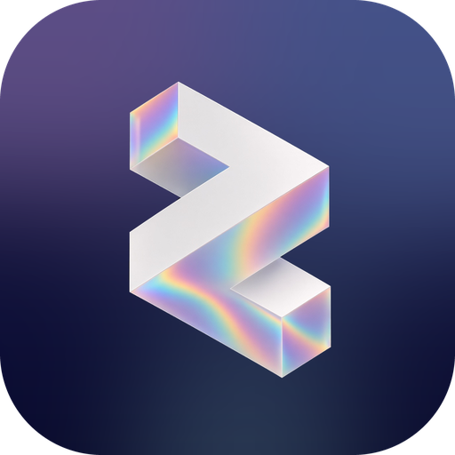

<div align="center">



# Zelefin

**Native Jellyfin, Silo, and Emby for iPhone, iPad, Mac, and Android.**  
Your server. Direct play. No Plus, no subscription, no in-app purchase.


[Jump](#what-you-get) · [Servers](#servers) · [Platforms](#who-gets-what) · [Run](#run-it) · [Plugin](https://github.com/rndllb/Zelefin-Plugin) · [Site](https://zelefin.app)

</div>

---

## Servers

<table>
<tr>
<td width="33%" valign="top">

**🪼 Jellyfin** · ready

Sign in with URL, username, and password, or Quick Connect. Extra accounts live in the profile sheet. Full admin, SyncPlay, Live TV (iOS), and lock-screen alerts through the Zelefin plugin.

</td>
<td width="33%" valign="top">

**🗄️ Silo** · ready

Sign in with your Silo account to pick a household profile (PINs and Silo’s avatars included), or as `username#profile` / Quick Connect. Libraries and playback run on Silo’s Jellyfin-compatible API, so its public address must be reachable wherever you watch; sign-in warns when it only works at home. Lock-screen alerts come from a personal webhook on the profile. Jellyfin-only tools Silo doesn’t serve stay hidden.

</td>
<td width="33%" valign="top">

**🟢 Emby** · ready

Its own API, not a Jellyfin fallback. Intro and credit skip from chapter markers, BIF scrubbing previews, collections, playlists, remote control, metadata and image editing, admin tools, Live TV, and the Open Subtitles plugin. Lock-screen alerts come from Emby’s Webhooks (Emby Premiere).

</td>
</tr>
</table>

Lock-screen alerts arrive while the app is closed on all three. Jellyfin uses the optional [Zelefin plugin](https://github.com/rndllb/Zelefin-Plugin), which also carries dashboard messages and Seerr requests. Emby and Silo can’t run it, so Settings → Notifications adds a webhook to your account that posts to Zelefin’s push service; Silo’s are signed and checked.

---

## What you get

<table>
<tr>
<td width="33%" valign="top">

### 🏠 Home

Continue watching, next up, and recently added movies and shows across every library, where new episodes bring a show back to the front. Reorder or hide rows. Featured hero from Interface settings.

</td>
<td width="33%" valign="top">

### 📚 Library

Movies, shows, collections, favorites, playlists. Filter by type, genre, year, rating. Sort, randomize, A–Z jump.

</td>
<td width="33%" valign="top">

### 🔎 Search

Search the signed-in server. **Discover** and request missing titles when Seerr is signed in.

</td>
</tr>
<tr>
<td width="33%" valign="top">

### 🎞️ Title

Backdrop, overview, seasons, similar, chapters, extras, special features. Play / resume with progress.

</td>
<td width="33%" valign="top">

### 👥 People

Cast and crew photos from the server. Open a person and browse their titles.

</td>
<td width="33%" valign="top">

### ⬇️ Downloads

Movies and episodes for offline play. Downloads tab with storage totals. Progress on posters and detail.

</td>
</tr>
<tr>
<td width="33%" valign="top">

### ▶️ Playback

Play, pause, skip, speed, audio, subtitles, chapters. Resume from the server. Direct play when the device can decode; transcode only when it cannot. MPV by default on both platforms, with every audio and subtitle track in the file in the menus; AetherEngine and Apple’s player on iPhone, ExoPlayer on Android.

</td>
<td width="33%" valign="top">

### 🎨 Picture & sound

HDR, Dolby Vision, Atmos badges when the file has them. Cinema bumpers. Skip Recap, Intro, Credits, and Preview, each with its own auto-skip. Styled anime subtitles. Subtitle size, color, and position.

</td>
<td width="33%" valign="top">

### 👯 SyncPlay

Jellyfin groups. Pause, seek, and play stay together — including with the official web client. The group waits, then everyone starts.

</td>
</tr>
<tr>
<td width="33%" valign="top">

### 📡 Sessions

See other devices, send play / playstate, send a Display Message. In-app popup while Zelefin is open.

</td>
<td width="33%" valign="top">

### 🔔 Notifications

Jellyfin: library adds, streams, users online, tasks, Seerr requests. Emby: new media, playback, recordings, sign-ins, tasks, server updates. Silo: new episodes of followed shows and request updates. Per-kind toggles and a test alert.

</td>
<td width="33%" valign="top">

### 🛠️ Admin

Jellyfin and Emby administrators: users, libraries, plugins, scheduled tasks, activity, scan, dashboard, metadata and image editing, identify. Backups and branding on Jellyfin.

</td>
</tr>
<tr>
<td width="33%" valign="top">

### ⚙️ Settings

Appearance, home rows, playback languages, downloads, notifications, which tabs sit in the dock, and the page the app opens to. Theme and poster text.

</td>
<td width="33%" valign="top">

### 🔌 Plugins

Intro Skipper or TheIntroDB, Open Subtitles (Jellyfin and Emby), Jellyfin Enhanced, Seerr / Jellyseerr (requests work without Sonarr or Radarr too). Emby gets skip times straight from TheIntroDB. First-run setup can install the Zelefin companion.

</td>
<td width="33%" valign="top">

### 🎲 Extra

Randomize in the library. Show tab names on the dock (on by default on Android). Review Demo on iPhone / iPad — no server.

</td>
</tr>
</table>

---

## Who gets what

| | iPhone / iPad | Mac | Android |
| :--- | :---: | :---: | :---: |
| Jellyfin · Silo · Emby | ✅ | ✅ | ✅ |
| Home, library, search, Discover | ✅ | ✅ | ✅ |
| Downloads & resume | ✅ | ✅ | ✅ |
| Direct play · HDR · Atmos | ✅ | ✅ | ✅ |
| Subtitle looks | ✅ | ✅ | ✅ |
| SyncPlay + official web | ✅ | ✅ | ✅ |
| Sessions & messages | ✅ | ✅ | ✅ |
| Lock-screen alerts (plugin or webhooks) | ✅ | Soon | ✅ |
| Jellyfin admin | ✅ | ✅ | ✅ |
| Seerr requests | ✅ | ✅ | ✅ |
| Live TV guide | ✅ | ✅ | — |
| Picture in Picture · AirPlay | ✅ | — | — |
| Review Demo | ✅ | ✅ | — |
| Chromecast | — | — | ✅ |
| MPV (default) | ✅ | ✅ | ✅ |
| ExoPlayer | — | — | ✅ |
| AetherEngine | ✅ | — | — |
| Material 3 chrome | — | — | ✅ |
| AVPlayer / VideoToolbox | ✅ | ✅ | — |

The Mac app is the iPad app built for the Mac (Mac Catalyst) and runs natively on Intel and Apple silicon (M-series) Macs with macOS 15 or later. It has a fixed sidebar like the TV app, with grids and rows sized for a Mac window. AetherEngine isn’t on the Mac until its FFmpeg ships Mac Catalyst builds, so the Mac plays with MPV or Apple’s player.

Android UI is Material 3: edge-to-edge navigation bar, accent-tinted surfaces, settings hub.

---

## Run it

<table>
<tr>
<td width="50%" valign="top">

### 🍎 Xcode

1. Open `IOS/Zelefin.xcodeproj`
2. Pick a simulator, a signed-in device, or **My Mac (Mac Catalyst)**
3. Run

MPV ships as a framework too large for git. Build it once with `IOS/scripts/build-mpv.sh` before the first run; it builds the iPhone, simulator, and Mac slices.

`IOS/project.yml` regenerates the project if you need XcodeGen.

[iOS notes →](IOS/README.md)

</td>
<td width="50%" valign="top">

### 🤖 Android Studio

1. Open the `Android/` folder
2. Pick an emulator or a USB-debugged device
3. Run the `app` configuration

Needs Android 8 (API 26)+.

[Android notes →](Android/README.md)

</td>
</tr>
</table>

**Needs:** iOS 18 (Liquid Glass on iOS 26), macOS 15 on an Intel or Apple silicon Mac, or Android 8+, and a Jellyfin or Emby server, or a Silo server with its Jellyfin-compatible API on, that the device can reach.

```bash
cd IOS
xcodebuild test -scheme Zelefin -destination 'platform=iOS Simulator,name=iPhone 17 Pro'
```

---

## Not in this build

<table>
<tr>
<td width="33%" valign="top">

🎵 **Music**

Not yet.

</td>
<td width="33%" valign="top">

🛒 **Stores**

iPhone and iPad beta on [TestFlight](https://testflight.apple.com/join/hHBVNKTj). Android from [zelefin.app/android](https://zelefin.app/android). Mac from source in Xcode for now. Free.

</td>
<td width="33%" valign="top">

🟠 **Plex**

Not yet.

</td>
</tr>
</table>

---

## License

Zelefin is free software under the [GNU General Public License v3.0](LICENSE). It plays video with [mpv](https://mpv.io) through an MPVKit build with AVFoundation video output on iPhone and iPad and [MPVKit](https://github.com/mpvkit/MPVKit) on the Mac (GPL-3.0; `IOS/scripts/build-mpv.sh` names the exact releases), alongside [AetherEngine](https://github.com/superuser404notfound/AetherEngine) and FFmpeg (LGPL-2.1). Skip times can come from [TheIntroDB](https://theintrodb.org).

---

<div align="center">

[Plugin](https://github.com/rndllb/Zelefin-Plugin) · [Privacy](https://zelefin.app/privacy) · [Terms](https://zelefin.app/terms) · [Support](https://zelefin.app/support) · [License](LICENSE)

</div>
